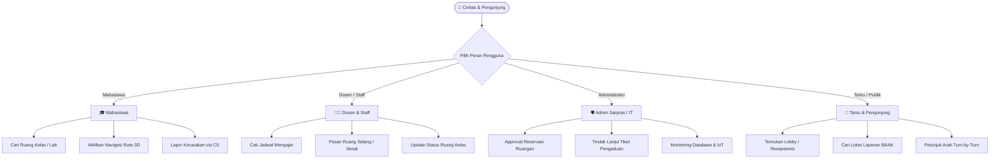

# 📖 BUKU PANDUAN PENGGUNA (USER GUIDE)
## SmartCampus3D — Universitas Siliwangi 🏛️📍

> **Sistem Informasi Tata Ruang, Denah Interaktif 3D/2D, & Navigasi Kampus Terpadu**  
> Gedung LABTEK 1 (Perkuliahan Terpadu & Laboratorium) & Gedung FT.1 (Dekanat & Pusat Riset)

---

## 🎯 1. Tujuan & Kebutuhan Sistem

Website **SmartCampus3D Universitas Siliwangi** dikembangkan untuk memenuhi kebutuhan utama civitas akademika dan masyarakat umum:

1. **Mengatasi Kesulitan Navigasi Kampus:**
   * Membantu mahasiswa baru, dosen tamu, maupun pengunjung dalam menemukan ruang kuliah, laboratorium, ruang sidang, dan loket layanan tanpa tersesat.
2. **Transparansi Ketersediaan Ruangan:**
   * Menampilkan status okupansi ruangan secara real-time (*Tersedia*, *Sedang Kuliah*, *Direservasi*, atau *Pemeliharaan*) agar civitas dapat merencanakan kegiatan akademik dengan efektif.
3. **Efisiensi Peminjaman Ruang Kuliah / Seminar:**
   * Memungkinkan dosen dan organisasi mahasiswa mengajukan reservasi ruangan secara langsung dengan validasi otomatis agar tidak terjadi bentrok jadwal.
4. **Respon Cepat Pengaduan Fasilitas (Customer Service):**
   * Menyediakan saluran pengaduan langsung terkait kerusakan fasilitas (AC mati, proyektor HDMI tidak tampil, spidol habis, WiFi lambat) ke bagian Sarana Prasarana (Sarpras) & IT.

---

## 👥 2. Panduan Berdasarkan Peran (Role-based Guide)

Sistem membedakan akses dan kebutuhan menjadi 4 kategori pengguna:

---

### 🎓 A. Panduan untuk Mahasiswa
*Akun Demo: `dimas.aditya@student.ac.id` / Password: `student`*

#### Kebutuhan Utama:
* Menemukan ruang kuliah teori, lab praktikum komputer, dan ruang sidang skripsi.
* Mengetahui apakah kelas sedang kosong untuk belajar mandiri atau diskusi kelompok.
* Melaporkan fasilitas kelas yang rusak agar segera diperbaiki.

#### Langkah-langkah Praktis:
1. **Mencari Ruang Kelas Cepat (Spotlight Search):**
   * Tekan tombol `Ctrl + K` pada keyboard (atau klik tombol **Cari** di navigasi atas).
   * Ketik kode ruangan (misal: `A-101`) atau nama mata kuliah (misal: `Algoritma`).
   * Klik hasil pencarian, sistem akan otomatis mengarahkan denah dan menyorot ruangan tersebut.
2. **Menampilkan Rute Jalan Menuju Ruangan:**
   * Klik ruangan target di denah (2D atau 3D).
   * Pada panel detail ruangan yang muncul, klik tombol hijau **"Tampilkan Rute Jalan"**.
   * Garis rute belokan demi belokan (*turn-by-turn path*) akan muncul dari posisi tangga/lobby terdekat menuju pintu ruangan.
3. **Mengajukan Peminjaman Ruang Belajar:**
   * Cari ruangan yang bertanda hijau (**Tersedia**).
   * Klik tombol **"Ajukan Peminjaman"**, isi formulir nama, keperluan kegiatan, tanggal, dan durasi jam.
4. **Melaporkan Fasilitas Rusak:**
   * Klik tombol melayang **"Layanan CS"** di pojok kanan bawah.
   * Pilih jenis kendala (AC, Proyektor, WiFi, Kebersihan) dan masukkan nomor ruangan. Tiket akan langsung diterima petugas Sarpras.

---

### 👨‍🏫 B. Panduan untuk Dosen & Staff Akademik
*Akun Demo: `siti.staff@smartspace.ac.id` / Password: `staff`*

#### Kebutuhan Utama:
* Mengetahui jadwal penggunaan ruang kuliah untuk kelas pengganti (*make-up class*).
* Memesan ruang sidang skripsi atau ruang rapat senat.
* Memastikan fasilitas ruang (proyektor laser, unit AC, smart display) berfungsi optimal.

#### Langkah-langkah Praktis:
1. **Memeriksa Ketersediaan Ruangan:**
   * Pada menu atas, gunakan dropdown **Filter Status** dan pilih **"Tersedia Saja"**.
   * Ruangan yang kosong akan tersaring otomatis lengkap dengan informasi kapasitas mahasiswa, jumlah AC, dan suhu telemetri IoT.
2. **Memesan Ruang Sidang Skripsi & Rapat Senat:**
   * Pilih **Gedung LABTEK 1 Lantai 2** -> Klik **Ruang A-203 (Ruang Sidang Skripsi)**, ATAU:
   * Pilih **Gedung FT.1 Lantai 2** -> Klik **Ruang B-201 (Ruang Sidang Senat Akademik)**.
   * Klik tombol **"Ajukan Peminjaman"** dan masukkan agenda rapat/sidang tugas akhir.
3. **Mengubah Status Okupansi Ruang:**
   * Setelah selesai menggunakan ruangan kelas, buka panel detail ruangan dan klik status **"Tersedia"** agar dosen atau staf lain dapat menggunakannya.

---

### 🛡️ C. Panduan untuk Administrator Sarpras & IT
*Akun Demo: `admin.kampus@smartspace.ac.id` / Password: `admin`*

#### Kebutuhan Utama:
* Monitoring menyeluruh keterisian seluruh lantai gedung.
* Menindaklanjuti dan menyelesaikan keluhan fasilitas dari mahasiswa/dosen.
* Menjaga sinkronisasi database MySQL dengan server real-time.

#### Langkah-langkah Praktis:
1. **Master Update Status Ruangan:**
   * Administrator memiliki wewenang penuh untuk mengubah status ruangan mana pun menjadi:
     * 🟢 **Tersedia (Available):** Ruangan siap pakai.
     * 🔴 **Terisi (Occupied):** Sedang berlangsung kuliah resmi.
     * 🟡 **Reservasi (Reserved):** Sudah dipesan untuk seminar/sidang.
     * ⚪ **Perbaikan (Maintenance):** Sedang dalam renovasi atau servis teknis.
   * Setiap perubahan langsung dipancarkan ke seluruh user melalui **Server-Sent Events (SSE)**.
2. **Mengelola Tiket Pengaduan Layanan CS:**
   * Buka panel **Layanan CS & Pengaduan Kampus**.
   * Lihat daftar tiket masuk dari mahasiswa/dosen (status: *Menunggu*, *Diproses*, *Selesai*).
   * Petugas dapat menugaskan teknisi dan memperbarui respon tiket secara real-time.
3. **Sinkronisasi Database:**
   * Seluruh riwayat transaksi tersimpan pada database MySQL `smartspace_db`.
   * Ekspor SQL cadangan selalu diperbarui di [`database/smartspace_db.sql`](../database/smartspace_db.sql).

---

### 👤 D. Panduan untuk Tamu & Pengunjung Umum
*Akun Demo: `tamu@external-visitor.com` / Password: `guest`*

#### Kebutuhan Utama:
* Menemukan kantor pimpinan fakultas (Dekanat), layanan administrasi, dan poliklinik kampus.
* Navigasi sederhana tanpa perlu registrasi akun yang rumit.

#### Langkah-langkah Praktis:
1. **Menuju Kantor Dekanat & Resepsionis:**
   * Pilih tombol gedung **"Gedung FT.1"** di bagian atas denah, pilih **Lantai 1**.
   * Ruangan **B-101** adalah Grand Lobby Dekanat & Meja Informasi.
   * Ruangan **B-102** adalah Kantor Dekan & Wakil Dekan.
2. **Menuju Layanan BAAK (Legalisir & Urusan Akademik):**
   * Pilih **Gedung LABTEK 1 Lantai 1**.
   * Ruangan **A-104** adalah Pusat Layanan BAAK.
3. **Layanan Kesehatan Darurat (Poliklinik P3K):**
   * Terletak di **Gedung FT.1 Lantai 1, Ruang B-106** untuk penanganan pertama civitas atau tamu yang kurang sehat.

---

## 🧭 3. Panduan Fitur Navigasi & Tampilan Denah

### A. Pilihan Tampilan Denah
Di bagian navigasi atas, Anda dapat memilih 3 mode tampilan:
* **📐 2D Denah (Blueprint SVG):**
  * Tampilan denah teknis arsitektur 2 dimensi. Sangat presisi, ringan, dan jelas untuk melihat tata letak partisi dinding dan pintu.
* **🏗️ 3D Model (Isometrik):**
  * Visualisasi isometrik 3 dimensi interaktif yang menampilkan ketinggian dinding, meja, dan model realistis seluruh lantai.
* **📋 Direktori Ruangan (List View):**
  * Tabel direktori ruangan lengkap dengan sorting, kapasitas, fasilitas AC, dan prodi pengampu.

### B. Indikator Warna Status Ruangan

| Warna | Label Status | Penjelasan |
| :--- | :--- | :--- |
| 🟢 **Hijau** | **Tersedia (Available)** | Ruangan sedang kosong, AC siap pakai, dapat dipinjam. |
| 🔴 **Merah** | **Terisi (Occupied)** | Sedang berlangsung proses perkuliahan atau ujian. |
| 🟡 **Kuning** | **Reservasi (Reserved)** | Telah dipesan untuk agenda akademik terjadwal. |
| ⚪ **Abu-abu** | **Perbaikan (Maintenance)** | Sedang dalam pemeliharaan sarana/instalasi IT. |

---

## ⌨️ 4. Shortcut Keyboard Cepat

| Tombol Shortcut | Aksi |
| :--- | :--- |
| `Ctrl + K` (atau `Cmd + K`) | Buka Search Engine Pencarian Cepat Ruangan |
| `F1` atau tombol `?` | Buka Buku Panduan Pengguna (User Guide Modal) |
| `Esc` | Menutup jendela modal / drawer yang sedang aktif |
| Tombol Bulan / Matahari | Beralih antara Dark Mode dan Light Mode |

---

## 📞 5. Kontak & Bantuan Kampus
* **Biro Sarana & Prasarana:** Gedung Rektorat Lt. 2 / Email: `sarpras@kampus.ac.id`
* **Helpdesk IT & Jaringan:** UPT Komputer Gedung LABTEK 1 Lt. 2 (Ruang A-206)
* **Layanan Pengaduan Online:** Tersedia melalui tombol melayang **"Layanan CS"** di aplikasi.

